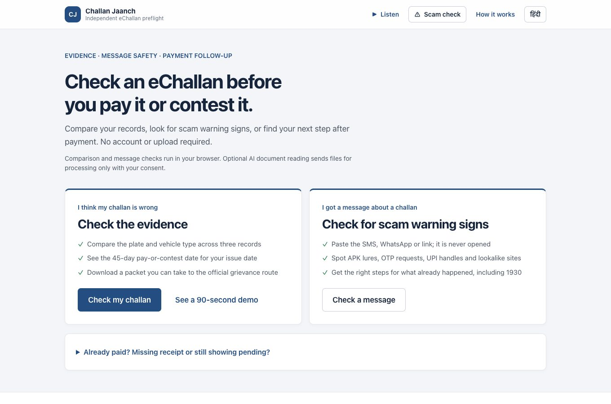

# Challan Jaanch

An independent English/Hindi companion for comparing eChallan evidence, checking suspicious messages and navigating payment problems.

**Live demo:** [challan-jaanch.deftsalt.chatgpt.site](https://challan-jaanch.deftsalt.chatgpt.site)



## What it does

- Compares user-confirmed plate, vehicle and duplicate-event evidence with deterministic rules.
- Refuses unsupported or ambiguous findings instead of guessing missing values.
- Checks pasted scam messages locally and offers exposure-specific next steps.
- Exports an attested evidence packet as PDF, JSON or a share-safe brief.
- Provides service-specific payment follow-up guidance without accessing financial records.

## Run locally

Use Node.js 22.13 or newer (`.nvmrc` selects Node 22):

```bash
git clone https://github.com/Deftsalt-debug/challan-jaanch.git
cd challan-jaanch
npm ci
npm run dev
```

Open [localhost:3000](http://localhost:3000). The synthetic demo, manual entry, Scam Shield and payment helper need no account or API key.
Optional AI extraction uses server-side configuration and explicit transmission consent; see [local development](docs/LOCAL_DEVELOPMENT.md).

## Tests

```bash
npm run verify
```

Runs lint, type checks, deterministic regression tests and a production build. CI runs the same checks on pushes and pull requests.
Tests cover evidence/refusal rules, scam signals, bilingual output, privacy boundaries, routing and payment guidance.
`npm run release:check` additionally audits production dependencies; run `npm audit` to include build-tool dependencies too.

## Architecture

| Layer | Implementation |
| --- | --- |
| Interface | React 19, TypeScript, Tailwind CSS 4; English and Hindi source copy |
| Hosting | Vinext/Vite, Next-compatible routes and Cloudflare Workers through Sites |
| Decisions | Pure local rules in `lib/cases.ts` and `lib/scam-shield.ts` |
| Optional extraction | Server-side OpenAI Responses API; observable fields only |
| Exports | jsPDF, JSON, clipboard and browser SHA-256 |
| Storage | In-memory case workspace; local language/theme preferences; no application database |

See [architecture and trust boundaries](docs/ARCHITECTURE.md) and the dated [payment research](docs/PAYMENT_RESEARCH.md).

## Known limits

The app does not authenticate senders, invalidate challans, verify payments, promise refunds or submit complaints.
Every decisive field needs human review against its source. Official services make the decision; procedures and guidance can change.
Citizen cases are not saved between sessions. The PDF is English-only; the interface and JSON claims preserve English and Hindi.
Optional AI processing sends selected files to the provider. `store: false` disables retrievable response storage, not all provider retention.
This is a prototype, not a government service or legal adviser; do not post real records or credentials in issues.

## Licence

[MIT](LICENSE).

## Credits

Created by [Deftsalt-debug](https://github.com/Deftsalt-debug), with Codex as the primary implementation partner for the workbench, rules, refusal paths, exports, bilingual interface, tests and deployment.
Product decisions and release authority remained with the creator. Existing author and AI co-author attribution is retained in Git history.
Official guidance sources are identified in the code and [payment research](docs/PAYMENT_RESEARCH.md). See [contributing](CONTRIBUTING.md).

## Hackathon submission

The original 1:47.5 silent video used the 28 August 2026 synthetic interface; its UI and test counts are historical.
The recording and production assets have been removed from the current tree. An external video link is pending from the maintainer.
Its “storage disabled” caption referred to `store: false`, not zero provider retention.
